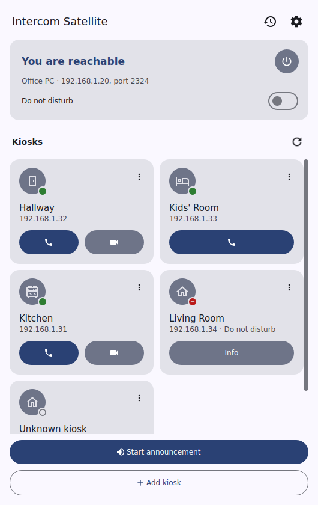
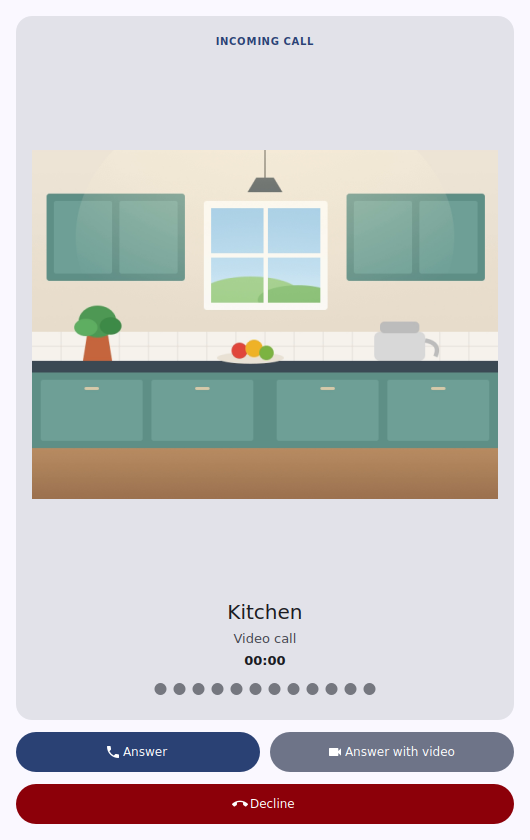
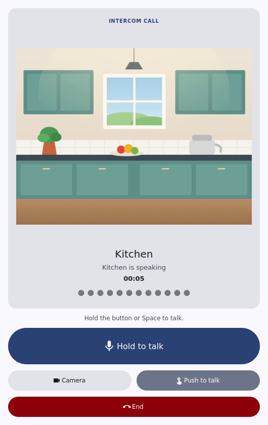
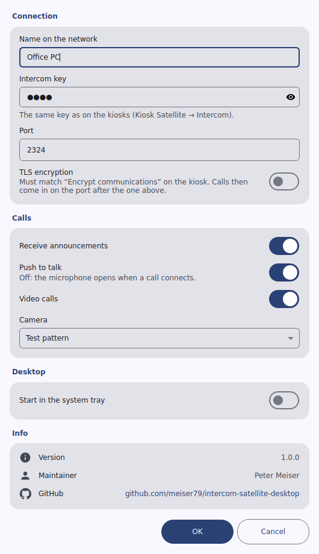
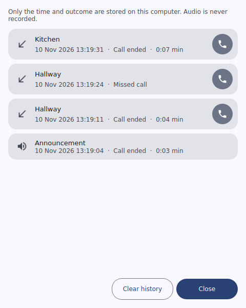

# Intercom Satellite Desktop App

The Intercom Satellite Desktop App turns a Linux computer into an intercom for [Kiosk Satellite](https://github.com/jxlarrea/kiosk-satellite) kiosks. It also works with the Intercom Satellite app on Android phones. It handles calls, video calls and announcements on the local network.

The Desktop App is an independent companion and not affiliated with Kiosk Satellite.

## Screenshots

| Kiosks | Incoming video call |
|---|---|
|  |  |
| **Video call** | **Settings** |
|  |  |
| **Call history** | |
|  | |

The kiosks in the screenshots are simulated, and the kitchen is a drawing.

## Features

- Finds kiosks and phones on the network over mDNS, without needing avahi. Kiosks can also be added by address.
- Each kiosk can get its own name and room symbol in the Desktop App, and the kiosk list fits more of them side by side in a wider window.
- Calls and video calls to a kiosk. Announcements go to one kiosk or to all reachable ones.
- A call history of calls and announcements, from which a kiosk can be called again. Only the time and outcome are stored, never audio, and the history can be cleared.
- Incoming calls ring and bring up the window. Closing or minimizing the window keeps the Desktop App running in the system tray. The tray menu answers and ends calls, starts an announcement and turns Do not disturb on or off. Starting the Desktop App again brings up its window instead of a second copy.
- Push to talk (with the button or by holding Space) or an open microphone, set in **Settings**.
- Video in both directions, from a camera through Qt Multimedia or from a test pattern. Video is H.264 through FFmpeg.
- Encrypted calls (TLS), like Kiosk Satellite's "Encrypt communications", with each kiosk's certificate confirmed once by its fingerprint.
- Do not disturb and the option to refuse announcements.
- English and German.

## Build

You need Ubuntu 26.04, or a similar distribution with Qt 6.4 or newer:

```sh
sudo apt install cmake ninja-build g++ pkg-config \
    qt6-base-dev qt6-multimedia-dev qt6-websockets-dev qt6-tools-dev qt6-l10n-tools \
    libavcodec-dev libavutil-dev libswscale-dev libssl-dev
cmake -B build -G Ninja -DCMAKE_BUILD_TYPE=Release
cmake --build build
ctest --test-dir build
```

Run the Desktop App with `build/intercom-satellite`. To install it with its menu entry, run `sudo cmake --install build`. To build a .deb package, run `dpkg-buildpackage -us -uc -b` in the source folder; the package lands next to it.

## Setup

1. Open **Settings** and enter a name. Also enter the intercom key from Kiosk Satellite, found in the kiosk's **Intercom** settings.
2. Kiosks should show up by themselves. If none does, the network may be blocking mDNS: choose **Add kiosk** and enter the kiosk's address.
3. The Desktop App listens for calls on port 2324. A firewall has to let in TCP 2324 and UDP 5353 (mDNS).

Settings are stored in `~/.config/intercom-satellite/settings.conf`. Only you can read this file, because it holds the intercom key and the app's TLS key.

## Encryption (TLS)

Turn on **TLS encryption** in **Settings** when the kiosks have "Encrypt communications" turned on. TLS has to be on or off on both sides alike; a kiosk with the other setting shows "TLS setting differs".

With TLS on, calls come in encrypted on the port after the plain one, so 2325 by default, and a firewall has to let in that port too. The plain port then only tells other devices where to find the encrypted one.

The Desktop App makes its own certificate the first time TLS is turned on. Kiosks have certificates of their own, which no authority signs. So the first time the app sees a kiosk's certificate, the kiosk shows **Confirm certificate**. Choose it and compare the SHA-256 fingerprint shown with the one on the kiosk before you choose **Trust**. After that, only this certificate is accepted for that kiosk. If a kiosk ever shows another certificate, it asks for confirmation again. A kiosk that calls the Desktop App before its certificate is confirmed shows **Confirm certificate** on the call screen, and the call can be answered only after that.

## Command line

| Option | |
|---|---|
| `--config <file>` | use another settings file; one Desktop App runs per settings file, so a second file runs a second instance |
| `--no-mdns` | don't announce this computer or look for kiosks |
| `--call <address or name>` | call a kiosk once it is reachable |
| `--video` | with `--call` or `--auto-answer`: turn video on |
| `--auto-answer` | answer calls after a second |

## Testing without a kiosk

`tools/kiosk-sim` holds a kiosk simulator in Python. It stands in for a kiosk when testing the Desktop App or the Android app. See its [README](tools/kiosk-sim/README.md).

## License

Apache License 2.0, see [LICENSE](LICENSE) and [NOTICE](NOTICE).
